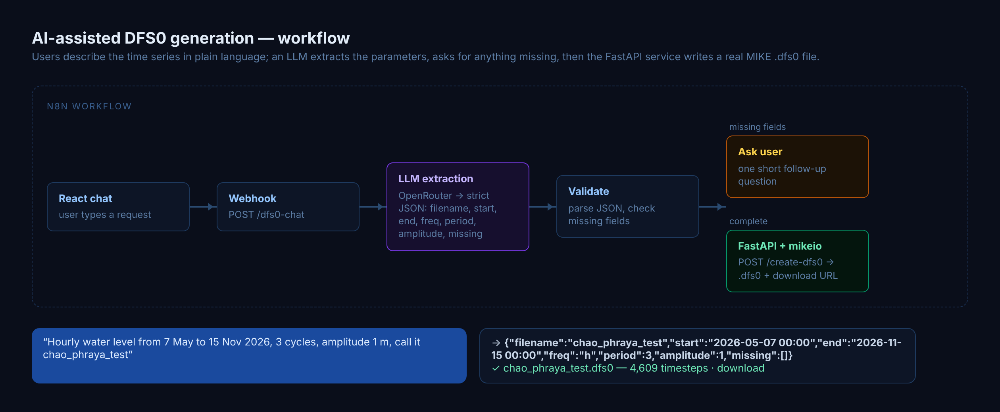
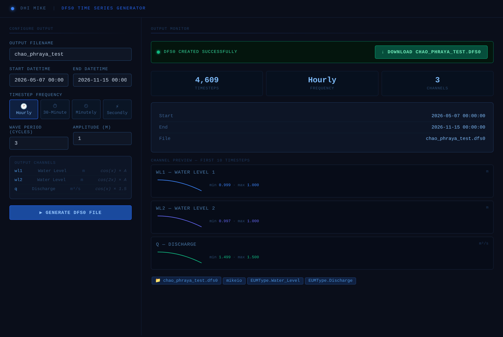
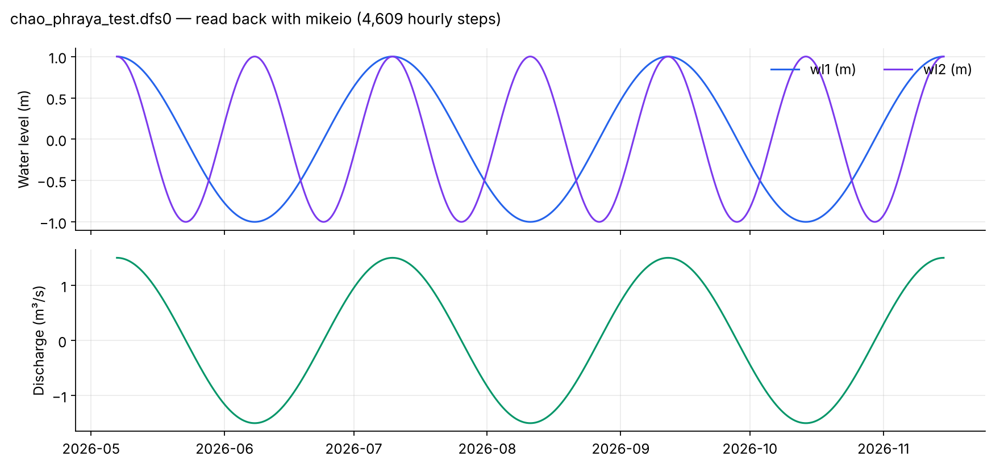

# DFS0 Generator

Describe a time series in plain language and get a ready-to-use DHI MIKE `.dfs0` file. An LLM extracts the parameters, asks for anything missing, and a FastAPI + mikeio service writes the file.

> Public case study — source code not included.

**Stack:** React · n8n · OpenRouter (LLM) · FastAPI · mikeio
